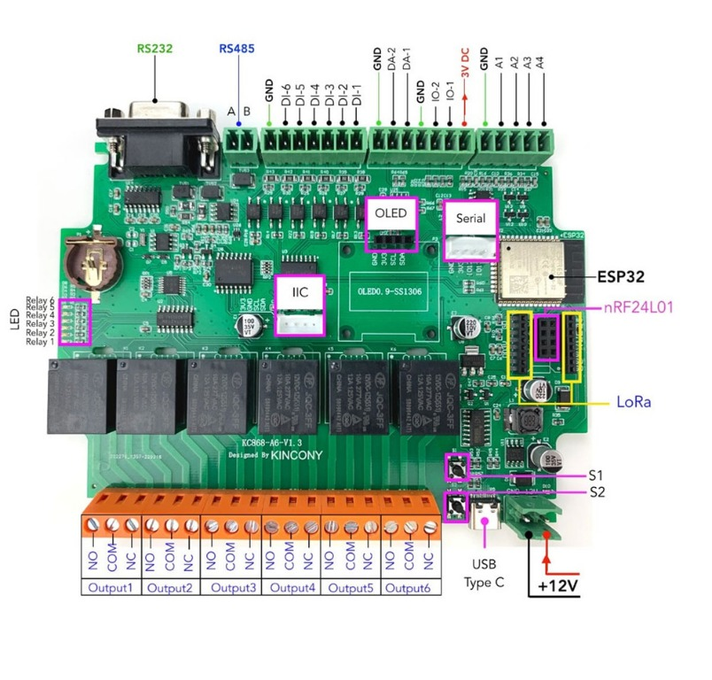
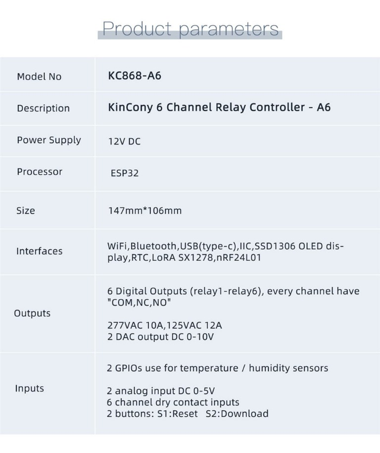
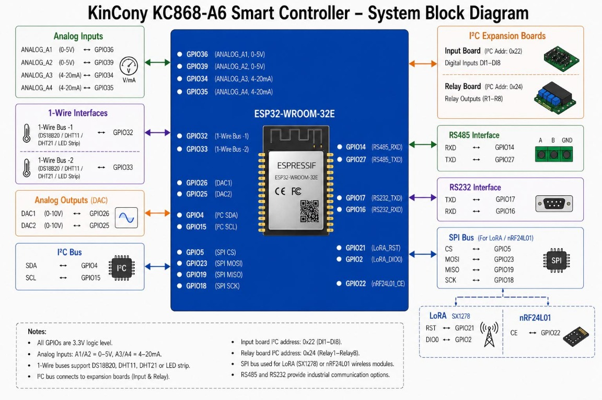

# Board resources and wiring

[Documentation index](./README.md) · [Project README](../README.md)

| Resource | ESP32 / bus | Notes |
| --- | --- | --- |
| Relay outputs 1-6 | I2C PCF8574, address `0x24`, P0-P5 | Active-low; startup writes all-high (OFF). P6-P7 are reserved. |
| Digital inputs 1-8 | I2C PCF8574, address `0x22`, P0-P7 | Read as an active-low raw byte. |
| Analog inputs A1-A4 | GPIO36, GPIO39, GPIO34, GPIO35 | ADC1, board conditioning accepts 0-5 V; readings are raw 12-bit counts. |
| Configurable sensor 1 | GPIO32 | Select OFF, DS18B20, DHT22 or DHT11 in the Sensors page. Default: DHT22. |
| Configurable sensor 2 | GPIO33 | Select OFF, DS18B20, DHT22 or DHT11 in the Sensors page. Default: OFF. |
| SSD1306 OLED | I2C address `0x3C`, SDA GPIO4, SCL GPIO15 | One OLED configuration section; status, sensor, air or custom grid pages. |
| BME680 | I2C address `0x77`, SDA GPIO4, SCL GPIO15 | Temperature, humidity, pressure and gas resistance. |
| ENS160 | I2C address `0x53`, SDA GPIO4, SCL GPIO15 | AQI, TVOC and eCO2. |
| QMC5883L compass | I2C address `0x0D`, SDA GPIO4, SCL GPIO15 | X/Y/Z magnetic readings. |
| DAC1, DAC2 | GPIO26, GPIO25 | Current firmware's DA labels; DA terminals have onboard LM258 conditioning. GPIO and terminal voltages differ; verify revision, waveform and calibration. |
| I2C | SDA GPIO4, SCL GPIO15 | PCF8574 input and relay expanders. |
| RS-485 | RX GPIO14, TX GPIO27 | UART2 (`Serial2`), 9600 8N1 starter setting. |
| RS-232 | RX GPIO17, TX GPIO16 | UART1 (`Serial1`), 9600 8N1 starter setting. |
| P17 TTL header pins | GPIO12, GPIO13 | Hardware UART1 or UART2 can be routed here; planned host TX12/RX13. Not a fourth UART. Currently unused as UART; GPIO12 is a strapping pin and GPIO13 conflicts with PN532 CS. |
| Shared SPI | SCK GPIO18, MISO GPIO19, MOSI GPIO23, CS GPIO5 | LoRa SX1278 or nRF24L01 module interface. |
| LoRa SX1278 | RESET GPIO21, DIO0 GPIO2 | Shares SPI; optional module. |
| nRF24L01 | CE GPIO22 | Shares SPI; optional module. |
| PN532 NFC | CS GPIO13, SCK GPIO18, MISO GPIO19, MOSI GPIO23 | Set the PN532 module to SPI mode. |
| USB/programming UART | RX GPIO3, TX GPIO1 | UART0, used by USB serial bridge. |
| Boot button | GPIO0 | ESP32 boot strap / download-mode button. |
| Reset | EN | Hardware reset; not a normal GPIO. |
| Wi-Fi / Bluetooth | ESP32-WROOM-32 radio | No external GPIO assignment. |

## Manufacturer reference images

These supplied manufacturer illustrations are useful for identifying board
connectors and advertised product features. Always confirm wiring against the
schematic and PCB revision for the board being installed.

*Board overview labeled KC868-A6 V1.3. Connector and optional-module labels
are visual references; they do not show every pin conflict in this firmware.*

*Manufacturer product-parameter sheet. It advertises six relay outputs, two
DAC outputs and two 0–5 V analog inputs; verify the exact PCB and signal
conditioning before connecting a load or sensor.*

*Manufacturer system block diagram. The illustration describes some analog
channels as 4–20 mA and shows an expander with eight relay outputs, which does
not match every A6 product-sheet/schematic description. Treat it as a
high-level illustration, not an electrical wiring authority.*

For board-specific wiring and revision notes, see
[manufacturer sources](./manufacturer-sources.md) and the official
[KC868-A6 product/schematic page](https://www.kincony.com/esp32-6-channel-relay-module-kc868-a6.html).

The manufacturer schematic is used for the peripheral wiring. Older
manufacturer forum replies list the LoRa RESET/DIO0 lines differently (GPIO14
and GPIO21); the schematic and currently edited post label RESET as GPIO21 and DIO0 as GPIO2.
GPIO14 is also the schematic's RS-485 RX line, so the radio forum mapping must
not be applied together with RS-485. Verify the PCB revision before enabling
optional radio modules.
Manufacturer RS232 TX17/RX16 differs from the preserved firmware TX16/RX17.
See [manufacturer evidence and revision warnings](./manufacturer-sources.md).
For calibrated current sensors and loop receivers, read
[current-measurement wiring requirements](./current-measurement.md).

The maintained build profiles are `kc868-a6` and `kc868-a6-coprocessor`
(`default_envs`). LoRa, nRF24 and GPS are still available as optional
compile-time flags instead of separate PlatformIO environments. LoRa and nRF24
share the SPI bus and board CS GPIO5, so select one radio per build.
See [build options and dependency requirements](./build.md#deployment-precautions-and-current-profiles)
before enabling optional flags.
For SX1278, override `-DLORA_FREQUENCY_HZ=...` with your module frequency.
GPIO2 is an ESP32 strapping pin; keep external circuitry from forcing an
incompatible level during reset. PN532 uses SPI with its own CS on GPIO13 and
may share the SPI bus with either radio.

At startup, firmware scans I2C addresses `0x08` through `0x77` and reports
detected addresses in the Interfaces page. GPIO12/13 are separate from the
RS-232 UART on GPIO16/17, but firmware does not enable them as a TTL UART. They
are 3.3 V pins; GPIO12 is a boot-strapping pin and GPIO13 is also the PN532 SPI
chip-select. Do not connect TTL logic directly to RS-232 voltage levels.

The planned P17 coprocessor link uses host TX GPIO12 to peer RX and host RX
GPIO13 to peer TX, with common ground and compatible logic levels. These
pins are separate from the board's serial transceivers, but routing UART1
or UART2 to P17 replaces that controller's RS-232 or RS-485 role. ESP32 has
three UART controllers in total, including USB/log UART0. Baud rates such as
460800 are possible with hardware UART, subject to peer and wiring tests.
P17 RX GPIO13 cannot run alongside the current PN532 CS GPIO13 assignment.
Verify boot-strapping behavior, connector orientation and the auxiliary
3.3 V supply budget before connecting a peer. The current pin header uses
legacy `ttlRx=12` / `ttlTx=13` names; the proposed reversed TX/RX assignment
is documented for future implementation, not enabled by this documentation.

The RF24 IFTTT action sends a 32-bit `uint32_t` payload at 1 Mbps on channel 76
to pipe address `E8E8F0F0E1`. The receiving nRF24 device must use the same
channel, address and payload size; this is not a generic arbitrary remote
control protocol. Received 32-bit packets can be used as numeric IFTTT input.
The Interfaces page keeps a 16-packet receive history. Selected received
payloads can be saved in NVS and manually replayed or selected as an IFTTT
action; replay always uses the configured channel and pipe above.
Connect BME680 to VCC/GND and I2C SDA GPIO4/SCL GPIO15 (address `0x77`), ENS160
to the same I2C pins (address `0x53`), and QMC5883L to the same I2C pins
(address `0x0D`). PN532 must use SPI: CS GPIO13, SCK GPIO18, MISO GPIO19,
MOSI GPIO23, plus VCC/GND. OLED settings appear once in the Interfaces form;
the corresponding inventory item only reports detection status.

## Sources

- [KC868-A6 product page and schematic](https://www.kincony.com/esp32-6-channel-relay-module-kc868-a6.html)
- [Manufacturer ESP32 I/O pin definition](https://www.kincony.com/forum/showthread.php?tid=1962)
