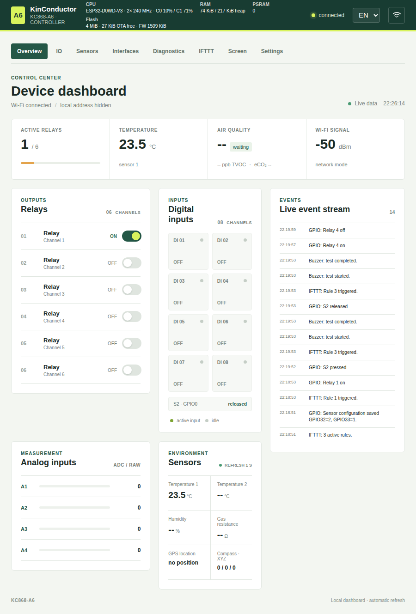
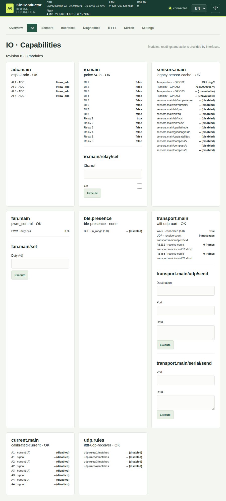
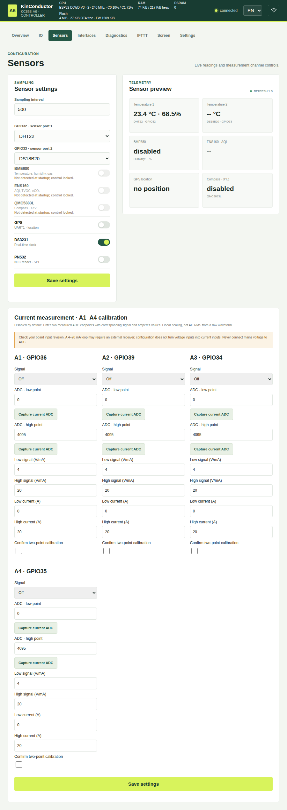
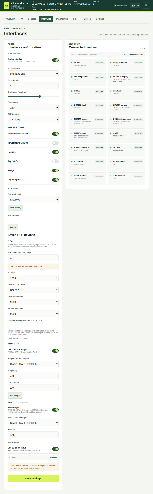
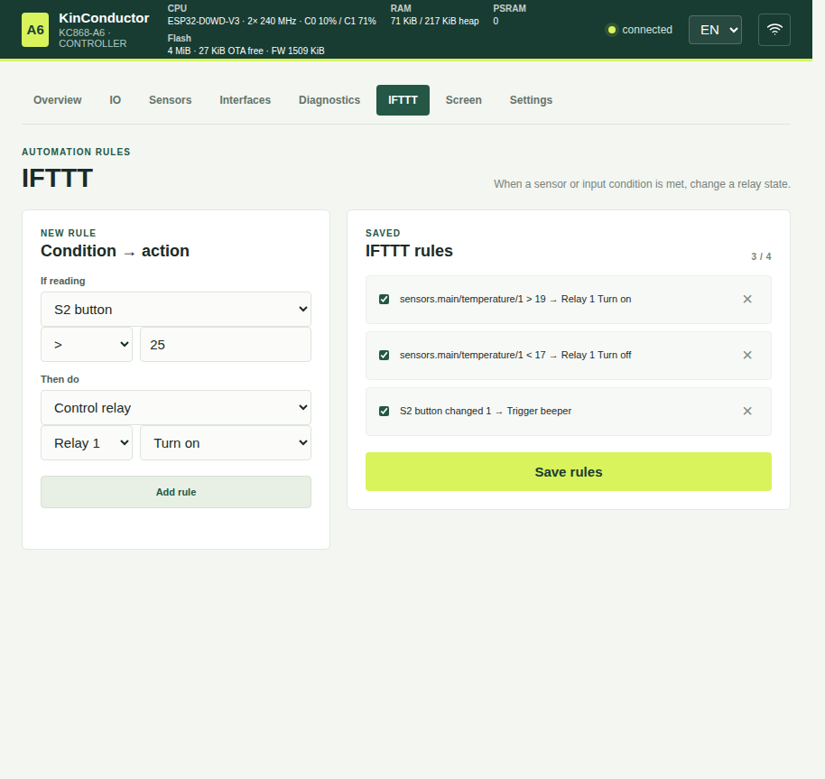
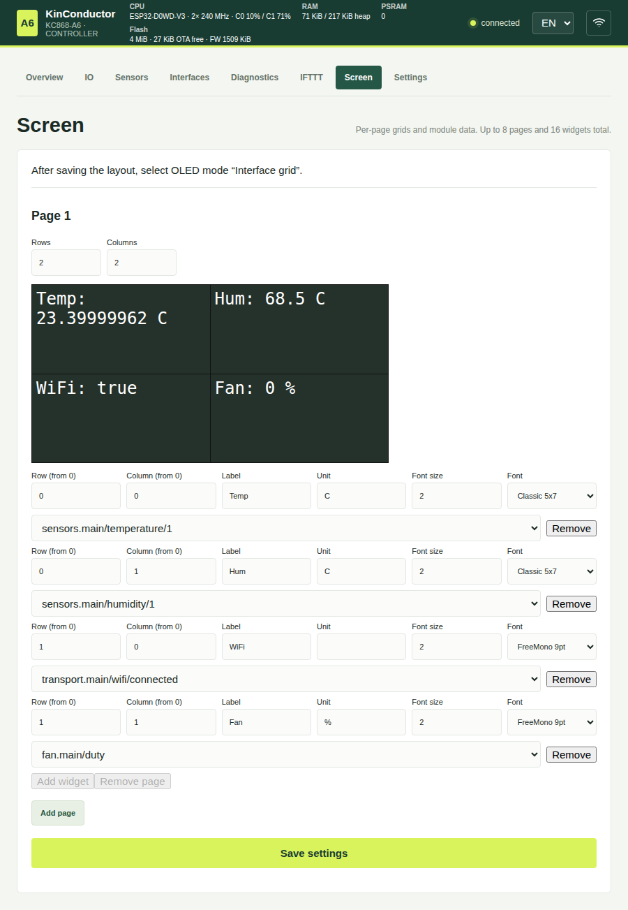
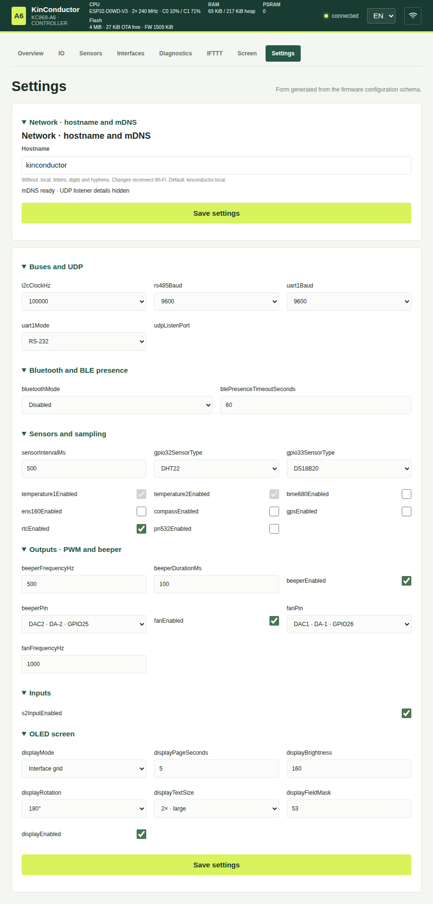
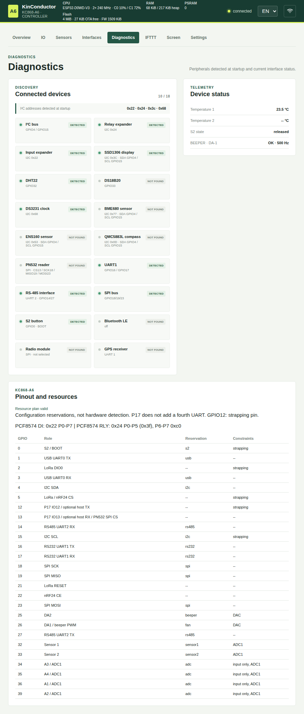

# WebGUI: pages, configuration and installation

[Wiki index](./README.md) · [First start](./first-start.md) ·
[Build and flashing](./build.md) · [Pinout and wiring](./hardware.md)

## Live screenshots from a working device

These screenshots were re-captured on 2026-10-31 from a working KC868-A6 with
the interface language set to **EN**. The device reported firmware **1.1.0**,
Wi-Fi was connected, and the status, configuration and capabilities endpoints
returned HTTP 200. These are captures of a live instance, not mockups or images
generated from HTML.

The network name, IP address, BLE MAC and UDP port have been redacted. Firmware
event-log entries originally returned in Polish were translated in the
screenshots only; the device configuration was not changed. Sensor readings,
statuses and settings show the state at capture time and may change. The
repository contains newer WebGUI code; to compare against the current
interface, flash firmware and LittleFS assets from the same commit. Do not
treat these images as evidence that features added after firmware 1.1.0 work.

## Dashboard



The overview shows connection status, basic measurements, relays and digital
inputs, analog inputs, and recent events. A relay switch changes a physical
output. Check the connected load and device state before testing; an IFTTT
rule can trigger an action independently of manual control.

The header reports the CPU model, core count and clock speed, free/total heap,
PSRAM and flash. Additional values, such as free application-partition space
or per-core CPU utilization, depend on the firmware/WebGUI version.

## IO — capability readings and actions



IO cards are generated from the capabilities returned by the firmware. They
show each module, its status, properties and available actions; they are not a
fixed list tied only to the board name. Enter the required action parameters
and check their ranges before execution. Actions can change physical outputs
or send UDP or serial data.

## Sensors — sensors and current-input calibration



The sensor type selectors apply to GPIO32 and GPIO33: OFF, DS18B20, DHT22 or
DHT11. Enabling other sensors is subject to device detection and resource
conflicts. Readings depend on the connected hardware; `--` does not mean zero.

The current-measurement section has separate settings for inputs A1–A4.
Calibration is linear and requires two measured ADC points and corresponding
signal/current values. Changing the configuration does not add a shunt or a
4–20 mA loop receiver. Review [wiring and calibration requirements](./current-measurement.md)
before connecting a sensor.

## Interfaces — OLED, BLE, UART and UDP



This page groups interface configuration and detected-device status.
Depending on the firmware, it may include:

- OLED: enablement, page mode and duration, contrast, orientation, font scale
  and grid fields;
- Bluetooth LE: scan/beacon mode, scanning, saving a selected MAC and presence
  timeout; scanner and beacon modes are mutually exclusive;
- I²C/SPI and UART1/RS-232 and UART2/RS-485 ports: baud rates and device
  availability; selecting a UART mode replaces its previous role;
- UDP: receive port `udpListenPort`; `0` disables the listener, while an active
  listener binds to `0.0.0.0`. Configure the destination address/port
  separately in the UDP Send action.

Detecting a device does not always mean its driver is enabled. Saving or
starting a feature can be rejected when it conflicts with a GPIO or bus
reservation. See [pin resources and constraints](./hardware.md).

## IFTTT — triggers and actions



A rule combines a source, operator/threshold and action. Available sources and
actions depend on the modules registered and options enabled in that firmware.
The system stores up to eight rules, including multiple rules using the same
source. A composite action can contain up to eight actions and run them in
sequence (stop at the first failure) or best-effort (attempt all actions).
Best-effort execution is still synchronous on the MCU, not simultaneous. For
UDP, configure a rule receive port, sender filter and text match; at most four
distinct UDP ports can be listened to. Edge-triggered conditions run an action
when the condition changes from false to true, not on every refresh.

Start by adding and testing one rule while monitoring the event stream; only
then increase the number of automations. Do not test with a load that could
become unsafe if switched on unexpectedly.

## Screen — OLED grid



The layout defines rows/columns and widgets bound to module properties. Each
widget can have a position, label, unit, size and font. Saving the layout does
not automatically enable its rendering: select OLED mode “Interface grid” on
the **Interfaces** page. The form displays the page and widget limits.

## Settings — firmware-schema form



Form fields come from the schema exposed by the firmware and are grouped for
convenience. The UI groups do not create separate hardware configurations.
Saving can update several settings at once; review the selected fields before
submitting.

The hostname is saved separately. After a hostname change, the device
reconnects to Wi-Fi, so the panel may be briefly unavailable. Reconnect using
the new IP address or `http://<hostname>.local/`.

## Diagnostics — detected devices and resources



Diagnostics distinguishes peripheral detection from enablement and shows
resource reservations and constraints. The GPIO map belongs to a specific
firmware/board profile; it is not a universal pinout for all KC868-Ax boards.
For models other than the verified A6, check the exact schematic and PCB
revision.

## Flashing firmware and WebGUI assets

Install PlatformIO and the dependencies listed in `platformio.ini`. Connect
the board over USB, identify its serial port and explicitly select the profile
that matches the hardware. For the base KC868-A6, use:

```sh
pio run -e kc868-a6
pio run -e kc868-a6 -t upload --upload-port /dev/ttyUSB0
pio run -e kc868-a6 -t uploadfs --upload-port /dev/ttyUSB0
```

On Windows, replace `/dev/ttyUSB0` with the correct COM port, such as `COM5`.
Flash firmware and LittleFS with separate commands. Both must come from the
same version: uploading only firmware can leave an outdated UI, while
uploading only LittleFS can expose endpoints unsupported by the firmware.

Before uploading, confirm the board model and port, and disconnect loads that
could be unsafe during a restart. Standard `upload`/`uploadfs` preserve NVS.
Do not use `erase-flash`, change the partition table, or flash a factory image
as a routine update: a factory image can erase settings, Wi-Fi credentials and
calibration data. Package and tag instructions are in the
[releases chapter](./releases.md).

After startup, if no Wi-Fi network is saved, connect to the `KC868-A6-XXXX`
setup access point and open `http://192.168.4.1`. Save a network, then use the
IP address from the serial log or the mDNS hostname. On a regular network the
device requires Basic Auth. HTTP does not encrypt traffic: use only a trusted
local network and do not expose the port to the internet. See
[First start](./first-start.md) for details.
